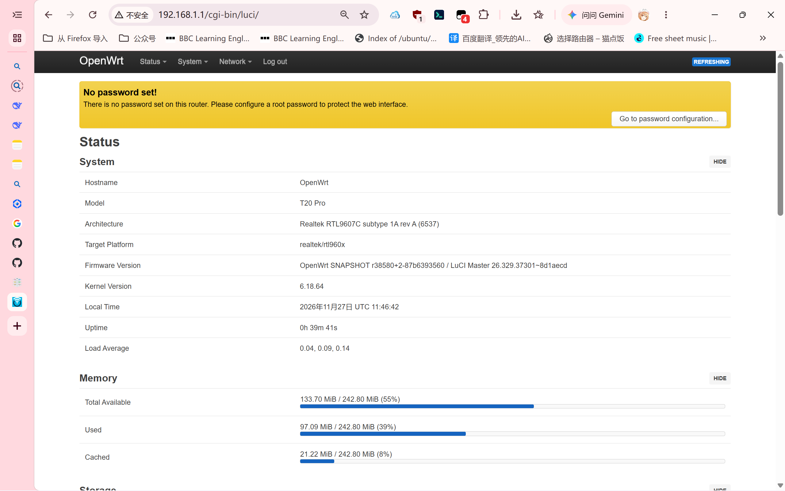

# TCL T20 Pro OpenWrt — Realtek RTL8198D / RTL960x

TCL T20 Pro 路由器 OpenWrt 固件移植与适配项目。

本项目基于 OpenWrt 源码，针对 TCL T20 Pro 路由器及 Realtek RTL8198D 芯片进行设备适配，提供 OpenWrt 固件编译、TTL 串口刷机、U-Boot TFTP 临时启动、Initramfs RAM 启动及 SquashFS 固件安装教程。

## English Introduction

OpenWrt port for the TCL T20 Pro router based on the Realtek RTL8198D SoC and RTL960x platform.

This repository provides OpenWrt source code, firmware build instructions, serial console access, U-Boot TFTP boot instructions, initramfs images and sysupgrade firmware installation procedures.

## 设备信息 / Device Information

- 设备型号：TCL T20 Pro
- 芯片平台：Realtek RTL8198D
- OpenWrt Target：realtek/rtl960x
- 设备标识：t20pro
- 刷机方式：TTL / U-Boot / TFTP / sysupgrade
- 固件类型：Initramfs / SquashFS

## 项目地址 / Repository

https://github.com/wjjsn/openwrt-t20pro

## TCL T20 Pro：编译和刷机

适用于 TCL T20 Pro（RTL8198D）。需要一台 Linux 电脑、网线和 TTL 串口（`115200 8N1`）。以下以 Debian/Ubuntu 为例；用普通用户编译。

### 1. 下载并编译

```sh
sudo apt update
sudo apt install build-essential clang flex bison g++ gawk gcc-multilib g++-multilib gettext git libncurses-dev libssl-dev python3 python3-setuptools rsync swig unzip zlib1g-dev file wget bzip2 zstd xz-utils dnsmasq-base screen
git clone --branch main https://github.com/wjjsn/openwrt.git
cd openwrt
./scripts/feeds update -a
./scripts/feeds install -a
cat > .config <<'EOF'
CONFIG_TARGET_realtek=y
CONFIG_TARGET_realtek_rtl960x=y
CONFIG_TARGET_realtek_rtl960x_DEVICE_t20pro=y
CONFIG_TARGET_ROOTFS_INITRAMFS=y
CONFIG_TARGET_INITRAMFS_COMPRESSION_NONE=y
CONFIG_TARGET_INITRAMFS_FORCE=y
CONFIG_TARGET_ROOTFS_SQUASHFS=y
EOF
make defconfig
make -j"$(nproc)" download
make -j"$(nproc)"
```

产物在 `bin/targets/realtek/rtl960x/`：`*-initramfs-kernel.bin` 用于临时启动，`*-squashfs-sysupgrade.bin` 用于安装。不要从原厂网页上传这两个文件。

### 2. 从 U-Boot 临时启动 OpenWrt

电脑网线插路由器 LAN，把 `enp3s0` 换成直连网卡名（用 `ip -br link` 查看）。在仓库根目录启动 TFTP，保持此终端运行：

```sh
IF=enp3s0
sudo ip link set "$IF" up
sudo ip addr add 169.254.84.248/16 dev "$IF"
sudo dnsmasq --no-daemon --port=0 --interface="$IF" --listen-address=169.254.84.248 --bind-interfaces --enable-tftp --tftp-root="$PWD/bin/targets/realtek/rtl960x"
```

另开终端运行 `sudo screen /dev/ttyUSB0 115200`（按实际串口设备名替换）。给路由器上电，看到 `Hit any key to stop autoboot` 时按空格，进入 `RTL8198D#`，执行：

```text
printenv sw_commit sw_active sw_tryactive
```

**刷完后要自动启动，设备必须已默认启动槽 1。** 实测环境为 `sw_commit=1`、`sw_active=1`、`sw_tryactive=2`。如果仍默认启动原厂槽 0，可以继续下面的 RAM 试启动，但不要执行第 3 步的写入；本流程不修改启动环境。不要运行 `saveenv`。

```text
setenv autostart no
setenv netretry no
setenv netmask 255.255.0.0
setenv ipaddr 169.254.84.249
setenv serverip 169.254.84.248
tftpboot 0x83000000 169.254.84.248:openwrt-realtek-rtl960x-t20pro-initramfs-kernel.bin
iminfo 0x83000000
bootm start 0x83000000
bootm loados
bootm go
```

传输失败、校验失败或解压失败就停下。临时系统启动完成后，按回车进入 OpenWrt 串口终端，再用 `Ctrl+C` 关闭电脑上的 TFTP 服务。

### 3. 刷入 Flash

在刚才运行 TFTP 的电脑终端里执行（如换了终端，请先重新设置 `IF`，并进入仓库根目录）：

```sh
sudo ip addr add 192.168.1.2/24 dev "$IF"
cd bin/targets/realtek/rtl960x
sha256sum openwrt-realtek-rtl960x-t20pro-squashfs-sysupgrade.bin
python3 -m http.server 8000 --bind 192.168.1.2
```

在 **OpenWrt 串口终端**下载安装包并计算 SHA-256：

```sh
wget -O /tmp/t20pro.bin http://192.168.1.2:8000/openwrt-realtek-rtl960x-t20pro-squashfs-sysupgrade.bin
sha256sum /tmp/t20pro.bin
```

确认与电脑打印的 SHA-256 一致后再刷入。`-n` 会清空 OpenWrt 设置；安装只更新槽 1 和 OpenWrt 配置卷，保留原厂槽与工厂数据。

```sh
sysupgrade -T /tmp/t20pro.bin && sysupgrade -n /tmp/t20pro.bin
```

等路由器自动重启，串口应显示从 `ubi_k1` 加载并挂载 SquashFS。关闭电脑上的 HTTP 服务，打开 [192.168.1.1](http://192.168.1.1/)。




启动的日志
```log
RTL9607C/RTL9603C
PRELOADER Bismarck3.5
II: LPLR:1126, SVN:d19878cc, Build_date:22050920, Toolkit:msdk-4.8.5-mips-EB-4.4-u0.9.33-m32ut-180206
II: Disable OCP/LX Timeout Monitor
II: SNAF version check OK!
II: TLB initial done:
    .ro section works!
    .text and .ro sections work!
␀␀II: CPU0 900MHz, CPU1 500MHz, DRAM 600MHz, LX 200MHz, SRAM 500MHz, SPIF 100MHz

AK: ******* DRAM calibration version: v4.2 *******
MEMPLL:[31/63/95/127/159/191/223]=407f, c0000210, 2ea23980, 2d0f0030, fff, 0, 0
AK: TP=3, VD=1, CC=3, OT=2, EP=0
AK: Start DDR3 Reset Procedure
ZQ:   Clock: ODT/OCD=30/48, zq_zctrl_prog=0x c080c3e, zq_zctrl_status=0x118344
ZQ: Address: ODT/OCD=30/80, zq_zctrl_prog=0x1c080c32, zq_zctrl_status=0x118300
ZQ:      DQ: ODT/OCD=30/60, zq_zctrl_prog=0x2c080c38, zq_zctrl_status=0x118322
ZQ:     DQS: ODT/OCD=30/60, zq_zctrl_prog=0x3c080c38, zq_zctrl_status=0x118322
ZQ: INTERAL DDR3, ZQCL done, ZQCS Enable
AK: MRS: mr[0]=0x101a50,  mr[1]=0x110004,  mr[2]=0x120010,  mr[3]=0x130000
AK: Bit/max_r_s/max_r_l/max_w_s/max_w_l    Bit/max_r_s/max_r_l/max_w_s/max_w_l
    [ 0]      0      1f       0      1d    [16]      2      1d       0      1f
    [ 1]      0      1f       0      1f    [17]      2      1d       0      1f
    [ 2]      0      1f       0      1d    [18]      0      1f       0      1f
    [ 3]      0      1f       0      1d    [19]      0      1f       0      1f
    [ 4]      0      1f       0      1d    [20]      0      1f       0      1d
    [ 5]      0      1f       0      1d    [21]      0      1f       0      1d
    [ 6]      0      1f       0      1d    [22]      0      1f       0      1f
    [ 7]      0      1f       0      1d    [23]      0      1f       0      1f
    [ 8]      0      1f       0      1b    [24]      2      1d       0      1b
    [ 9]      0      1f       0      1d    [25]      0      1f       0      1d
    [10]      0      1f       0      1d    [26]      0      1f       0      1d
    [11]      0      1f       0      1b    [27]      0      1f       0      1d
    [12]      0      1f       0      19    [28]      0      1f       0      1b
    [13]      0      1f       0      1b    [29]      0      1f       0      1b
    [14]      2      1d       0      1b    [30]      2      1d       0      1d
    [15]      0      1f       0      1b    [31]      2      1d       0      1d
AK: Let's calibrate DRAM again, it will be better!
AK: Group delay: DQS0=2, DQS1=2
AK: Bit/max_r_s/max_r_l/max_w_s/max_w_l    Bit/max_r_s/max_r_l/max_w_s/max_w_l
    [ 0]      0      1f       0      1d    [16]      0      1f       0      1f
    [ 1]      0      1f       0      1f    [17]      0      1f       0      1f
    [ 2]      0      1d       0      1d    [18]      0      1f       0      1f
    [ 3]      0      1d       0      1d    [19]      0      1f       0      1f
    [ 4]      0      1f       0      1d    [20]      0      1f       0      1d
    [ 5]      0      1d       0      1d    [21]      0      1f       0      1d
    [ 6]      0      1d       0      1d    [22]      0      1f       0      1f
    [ 7]      0      1d       0      1d    [23]      0      1f       0      1f
    [ 8]      0      1f       0      1b    [24]      0      1f       0      1b
    [ 9]      0      1f       0      1d    [25]      0      1f       0      1d
    [10]      0      1d       0      1d    [26]      0      1f       0      1d
    [11]      0      1d       0      1b    [27]      0      1f       0      1d
    [12]      0      1d       0      19    [28]      0      1f       0      1b
    [13]      0      1d       0      1b    [29]      0      1f       0      1b
    [14]      0      1f       0      1b    [30]      2      1d       0      1d
    [15]      0      1f       0      1b    [31]      0      1f       0      1d
AK: DRAM size=0x10000000, tRFC[2]=0x165(nS), tREF=1920(nS)
AK: DCR=0x21321003, DTR[0:2]=0x99644828, 0x808051f, 0x6516000
II: DDR3, 256MB
II: Change Stack from 0x9f002edc to 0x806fffe0
II: U-boot Magic Number is 0x27051956
II: Inflating U-Boot (0x80700040 -> 0x83c00000)... OK
II: Starting U-boot...


U-Boot 2011.12.NA (20220509 - 202738)

Board:RTL8198D, CPU:900MHz, LX:200MHz, MEM:600MHz, SPIF:100MHz, Type:DDR3
SPI-NAND Flash: CDEA11/Mode0 1x128MB
Create bbt:  113  226  339  452  565  678  791
RTK: Register new nand device
Loading 131072B env. variables from offset 0xc0000
Loading 131072B env. variables from offset 0xe0000
Loaded 131072B env. variables from offset 0xe0000
Net:   LUNA GMAC
Warning: eth device name has a space!

Hit any key to stop autoboot:  0
swcore_init
multicast_start Using LUNA GMAC  device
mcast upgrade timeout.
Creating 1 MTD partitions on "nand0":
0x000000100000-0x000007d80000 : "mtd=3"
detect block 113 is bad
detect block 226 is bad
detect block 339 is bad
detect block 452 is bad
detect block 565 is bad
detect block 678 is bad
detect block 791 is bad
good block number 1017
UBI: attaching mtd1 to ubi0
UBI: physical eraseblock size:   131072 bytes (128 KiB)
UBI: logical eraseblock size:    126976 bytes
UBI: smallest flash I/O unit:    2048
UBI: VID header offset:          2048 (aligned 2048)
UBI: data offset:                4096
UBI: attached mtd1 to ubi0
UBI: MTD device name:            "mtd=3"
UBI: MTD device size:            124 MiB
UBI: number of good PEBs:        996
UBI: number of bad PEBs:         0
UBI: max. allowed volumes:       128
UBI: wear-leveling threshold:    4096
UBI: number of internal volumes: 1
UBI: number of user volumes:     9
UBI: available PEBs:             11
UBI: total number of reserved PEBs: 985
UBI: number of PEBs reserved for bad PEB handling: 9
UBI: max/mean erase counter: 27/15
Read 6291456 bytes from volume ubi_k1 to 83000000
## Booting kernel from Legacy Image at 83000000 ...
   Image Name:   MIPS OpenWrt Linux-6.18.64
   Created:      2026-11-27   9:52:44 UTC
   Image Type:   MIPS Linux Kernel Image (lzma compressed)
   Data Size:    3199901 Bytes = 3.1 MB
   Load Address: 80100000
   Entry Point:  80100000
   Verifying Checksum ... OK
   Uncompressing Kernel Image ... OK

Starting kernel ...

[    0.000000] Linux version 6.18.64 (wjjsn@MYJGMC) (mips-openwrt-linux-musl-gcc (OpenWrt GCC 15.3.0 toolchain-e27d4eccb3) 15.3.0, GNU ld (GNU Binutils) 2.46.1) #0 SMP Fri Nov 27 09:52:44 2026
[    0.000000] printk: legacy bootconsole [early0] enabled
[    0.000000] CPU0 revision is: 0001a120 (MIPS interAptiv (multi))
[    0.000000] Realtek RTL9607C subtype 1A rev A (6537) SoC with 256 MB
[    0.000000] Adding initrd info from environment
[    0.000000] MIPS: machine is T20 Pro
[    0.000000] earlycon: ns16550a0 at MMIO 0x18002000 (options '115200n8')
[    0.000000] printk: legacy bootconsole [ns16550a0] enabled
[    0.000000] Initrd not found or empty - disabling initrd
[    0.000000] OF: reserved mem: Reserved memory: No reserved-memory node in the DT
[    0.000000] VPE topology {2,2} total 4
[    0.000000] Primary instruction cache 64kB, VIPT, 4-way, linesize 32 bytes.
[    0.000000] Primary data cache 32kB, 4-way, PIPT, no aliases, linesize 32 bytes
[    0.000000] MIPS secondary cache 256kB, 8-way, linesize 32 bytes.
[    0.000000] Zone ranges:
[    0.000000]   Normal   [mem 0x0000000000000000-0x000000000fffffff]
[    0.000000]   HighMem  empty
[    0.000000] Movable zone start for each node
[    0.000000] Early memory node ranges
[    0.000000]   node   0: [mem 0x0000000000000000-0x000000000fffffff]
[    0.000000] Initmem setup node 0 [mem 0x0000000000000000-0x000000000fffffff]
[    0.000000] percpu: Embedded 12 pages/cpu s18832 r8192 d22128 u49152
[    0.000000] pcpu-alloc: s18832 r8192 d22128 u49152 alloc=12*4096
[    0.000000] pcpu-alloc: [0] 0 [0] 1 [0] 2 [0] 3
[    0.000000] Kernel command line: console=ttyS0,115200 earlycon ubi.mtd=ubi_device,2048 ubi.block=0,ubi_r1 root=/dev/ubiblock0_4 rootfstype=squashfs firmware_class.path=/tmp/t20pro-firmware
[    0.000000] printk: log buffer data + meta data: 131072 + 409600 = 540672 bytes
[    0.000000] Dentry cache hash table entries: 32768 (order: 5, 131072 bytes, linear)
[    0.000000] Inode-cache hash table entries: 16384 (order: 4, 65536 bytes, linear)
[    0.000000] Writing ErrCtl register=00000000
[    0.000000] Readback ErrCtl register=00000000
[    0.000000] Built 1 zonelists, mobility grouping on.  Total pages: 65536
[    0.000000] mem auto-init: stack:off, heap alloc:off, heap free:off
[    0.000000] SLUB: HWalign=32, Order=0-3, MinObjects=0, CPUs=4, Nodes=1
[    0.000000] rcu: Hierarchical RCU implementation.
[    0.000000]  Tracing variant of Tasks RCU enabled.
[    0.000000] rcu: RCU calculated value of scheduler-enlistment delay is 10 jiffies.
[    0.000000] RCU Tasks Trace: Setting shift to 2 and lim to 1 rcu_task_cb_adjust=1 rcu_task_cpu_ids=4.
[    0.000000] NR_IRQS: 256
[    0.000000] rcu: srcu_init: Setting srcu_struct sizes based on contention.
[    0.000000] clocksource: jiffies: mask: 0xffffffff max_cycles: 0xffffffff, max_idle_ns: 19112604462750000 ns
[    0.000000] rtl83xx-clk: initialized, CPU 900 MHz, MEM 600 MHz (16 Bit DDR3), LXB 200 MHz
[    0.000000] No 'frequency' property in DT, using default.
[    0.000000] clocksource: realtek_otto_timer: mask: 0xfffffff max_cycles: 0xfffffff, max_idle_ns: 38225208801 ns
[    0.000003] sched_clock: 28 bits at 3125kHz, resolution 320ns, wraps every 42949672800ns
[    0.009367] Calibrating delay loop... 597.60 BogoMIPS (lpj=2988032)
[    0.076029] pid_max: default: 32768 minimum: 301
[    0.091558] Mount-cache hash table entries: 1024 (order: 0, 4096 bytes, linear)
[    0.099787] Mountpoint-cache hash table entries: 1024 (order: 0, 4096 bytes, linear)
[    0.126460] rcu: Hierarchical SRCU implementation.
[    0.131920] rcu:     Max phase no-delay instances is 1000.
[    0.139653] smp: Bringing up secondary CPUs ...
[    0.146156] Primary instruction cache 64kB, VIPT, 4-way, linesize 32 bytes.
[    0.146199] Primary data cache 32kB, 4-way, PIPT, no aliases, linesize 32 bytes
[    0.146213] MIPS secondary cache 256kB, 8-way, linesize 32 bytes.
[    0.146330] CPU1 revision is: 0001a120 (MIPS interAptiv (multi))
[    0.168665] Counter synchronization [CPU#0 -> CPU#1]: passed
[    0.207236] Primary instruction cache 64kB, VIPT, 4-way, linesize 32 bytes.
[    0.207281] Primary data cache 32kB, 4-way, PIPT, no aliases, linesize 32 bytes
[    0.207295] MIPS secondary cache 256kB, 8-way, linesize 32 bytes.
[    0.207371] CPU2 revision is: 0001a120 (MIPS interAptiv (multi))
[    0.249441] Counter synchronization [CPU#0 -> CPU#2]: passed
[    0.287064] Primary instruction cache 64kB, VIPT, 4-way, linesize 32 bytes.
[    0.287098] Primary data cache 32kB, 4-way, PIPT, no aliases, linesize 32 bytes
[    0.287112] MIPS secondary cache 256kB, 8-way, linesize 32 bytes.
[    0.287199] CPU3 revision is: 0001a120 (MIPS interAptiv (multi))
[    0.320656] Counter synchronization [CPU#0 -> CPU#3]: passed
[    0.356636] smp: Brought up 1 node, 4 CPUs
[    0.363505] Memory: 245968K/262144K available (8766K kernel code, 654K rwdata, 1068K rodata, 1280K init, 245K bss, 14796K reserved, 0K cma-reserved, 0K highmem)
[    0.384649] posixtimers hash table entries: 2048 (order: 2, 16384 bytes, linear)
[    0.393182] futex hash table entries: 1024 (32768 bytes on 1 NUMA nodes, total 32 KiB, linear).
[    0.408894] pinctrl core: initialized pinctrl subsystem
[    0.418036] NET: Registered PF_NETLINK/PF_ROUTE protocol family
[    0.425415] thermal_sys: Registered thermal governor 'step_wise'
[    0.425612] FPU Affinity set after 11940 emulations
[    0.465923] clocksource: Switched to clocksource realtek_otto_timer
[    0.483246] NET: Registered PF_INET protocol family
[    0.489071] IP idents hash table entries: 4096 (order: 3, 32768 bytes, linear)
[    0.498919] tcp_listen_portaddr_hash hash table entries: 512 (order: 0, 4096 bytes, linear)
[    0.508360] Table-perturb hash table entries: 65536 (order: 6, 262144 bytes, linear)
[    0.517077] TCP established hash table entries: 2048 (order: 1, 8192 bytes, linear)
[    0.525684] TCP bind hash table entries: 2048 (order: 3, 32768 bytes, linear)
[    0.533841] TCP: Hash tables configured (established 2048 bind 2048)
[    0.541809] MPTCP token hash table entries: 256 (order: 0, 4096 bytes, linear)
[    0.550419] UDP hash table entries: 256 (order: 2, 14336 bytes, linear)
[    0.557933] UDP-Lite hash table entries: 256 (order: 2, 14336 bytes, linear)
[    0.567132] NET: Registered PF_UNIX/PF_LOCAL protocol family
[    0.573576] PCI: CLS 0 bytes, default 32
[    0.580256] workingset: timestamp_bits=14 max_order=16 bucket_order=2
[    0.590796] squashfs: version 4.0 (2009/01/31) Phillip Lougher
[    0.597557] jffs2: version 2.2 (NAND) (SUMMARY) (ZLIB) (LZMA) (RTIME) (CMODE_PRIORITY) (c) 2001-2006 Red Hat, Inc.
[    0.621382] realtek-pcie 18b20000.pcie: host bridge /pcie@18b20000 ranges:
[    0.629227] realtek-pcie 18b20000.pcie:      MEM 0x001a000000..0x001affffff -> 0x001a000000
[    0.638639] realtek-pcie 18b20000.pcie:       IO 0x0018e00000..0x0018e0ffff -> 0x0000000000
[    0.648352] realtek-pcie 18b00000.pcie: host bridge /pcie@18b00000 ranges:
[    0.656134] realtek-pcie 18b00000.pcie:      MEM 0x0019000000..0x0019ffffff -> 0x0019000000
[    0.665470] realtek-pcie 18b00000.pcie:       IO 0x0018c00000..0x0018c0ffff -> 0x0000000000
[    0.678000] Serial: 8250/16550 driver, 2 ports, IRQ sharing disabled
[    0.719296] brd: module loaded
[    0.740389] rtl960x-gmac 18012000.ethernet eth0: RTL960X GMAC [mem 0x18012000-0x18013fff] irq 24
[    0.750788] i2c_dev: i2c /dev entries driver
[    0.764156] NET: Registered PF_INET6 protocol family
[    0.774341] Segment Routing with IPv6
[    0.778712] In-situ OAM (IOAM) with IPv6
[    0.783317] NET: Registered PF_PACKET protocol family
[    0.789875] 8021q: 802.1Q VLAN Support v1.8
[    0.842592] realtek-pcie 18b20000.pcie: host bridge /pcie@18b20000 ranges:
[    0.850438] realtek-pcie 18b20000.pcie:      MEM 0x001a000000..0x001affffff -> 0x001a000000
[    0.860317] realtek-pcie 18b20000.pcie:       IO 0x0018e00000..0x0018e0ffff -> 0x0000000000
[    1.097982] realtek-pcie 18b20000.pcie: link up, 5.0 GT/s PCIe
[    1.104889] realtek-pcie 18b20000.pcie: PCI host bridge to bus 0000:00
[    1.112300] pci_bus 0000:00: root bus resource [bus 00-ff]
[    1.118511] pci_bus 0000:00: root bus resource [mem 0x1a000000-0x1affffff]
[    1.126226] pci_bus 0000:00: root bus resource [io  0x0000-0xffff]
[    1.133255] pci 0000:00:00.0: [10ec:8196] type 01 class 0x060400 PCIe Root Port
[    1.141480] pci 0000:00:00.0: PCI bridge to [bus 00]
[    1.147060] pci 0000:00:00.0:   bridge window [io  0x0000-0x0fff]
[    1.153873] pci 0000:00:00.0:   bridge window [mem 0x00000000-0x000fffff]
[    1.161493] pci 0000:00:00.0:   bridge window [mem 0x00000000-0x000fffff pref]
[    1.169674] pci 0000:00:00.0: supports D1
[    1.174155] pci 0000:00:00.0: PME# supported from D0 D1 D3hot
[    1.180949] pci 0000:00:01.0: [10ec:8852] type 00 class 0x028000 PCIe Endpoint
[    1.189112] pci 0000:00:01.0: BAR 0 [io  0x0000-0x00ff]
[    1.194963] pci 0000:00:01.0: BAR 2 [mem 0x00000000-0x000fffff 64bit]
[    1.202274] pci 0000:00:01.0: supports D1 D2
[    1.207078] pci 0000:00:01.0: PME# supported from D0 D1 D2 D3hot D3cold
[    1.216165] pci 0000:00:00.0: bridge configuration invalid ([bus 00-00]), reconfiguring
[    1.225510] pci 0000:00:00.0: PCI bridge to [bus 01-ff]
[    1.231460] pci_bus 0000:01: busn_res: [bus 01-ff] end is updated to 01
[    1.238905] pci 0000:00:00.0: disabling bridge window [mem 0x00000000-0x000fffff pref] to [bus 01] (unused)
[    1.249822] pci 0000:00:00.0: disabling bridge window [mem 0x00000000-0x000fffff] to [bus 01] (unused)
[    1.260273] pci 0000:00:01.0: BAR 2 [mem 0x1a000000-0x1a0fffff 64bit]: assigned
[    1.268504] pci 0000:00:00.0: bridge window [io  0x0000-0x0fff]: assigned
[    1.276133] pci 0000:00:01.0: BAR 0 [io  0x1000-0x10ff]: assigned
[    1.282953] pci 0000:00:00.0: PCI bridge to [bus 01]
[    1.288537] pci 0000:00:00.0:   bridge window [io  0x0000-0x0fff]
[    1.295367] pci_bus 0000:00: resource 4 [mem 0x1a000000-0x1affffff]
[    1.302383] pci_bus 0000:00: resource 5 [io  0x0000-0xffff]
[    1.308710] pci_bus 0000:01: resource 0 [io  0x0000-0x0fff]
[    1.314954] pci_bus 0000:01: resource 1 [mem 0x00000000-0x000fffff disabled]
[    1.322847] pci_bus 0000:01: resource 2 [mem 0x00000000-0x000fffff pref disabled]
[    1.332015] realtek-pcie 18b00000.pcie: host bridge /pcie@18b00000 ranges:
[    1.339859] realtek-pcie 18b00000.pcie:      MEM 0x0019000000..0x0019ffffff -> 0x0019000000
[    1.349249] realtek-pcie 18b00000.pcie:       IO 0x0018c00000..0x0018c0ffff -> 0x0000000000
[    1.587946] realtek-pcie 18b00000.pcie: link up, 2.5 GT/s PCIe
[    1.594734] realtek-pcie 18b00000.pcie: PCI host bridge to bus 0001:00
[    1.602116] pci_bus 0001:00: root bus resource [bus 00-ff]
[    1.608296] pci_bus 0001:00: root bus resource [mem 0x19000000-0x19ffffff]
[    1.616011] pci_bus 0001:00: root bus resource [io  0x10000-0x1ffff] (bus address [0x0000-0xffff])
[    1.626117] pci 0001:00:00.0: [10ec:8196] type 01 class 0x060400 PCIe Root Port
[    1.634306] pci 0001:00:00.0: PCI bridge to [bus 00]
[    1.639883] pci 0001:00:00.0:   bridge window [io  0x10000-0x10fff]
[    1.646931] pci 0001:00:00.0:   bridge window [mem 0x00000000-0x000fffff]
[    1.654527] pci 0001:00:00.0:   bridge window [mem 0x00000000-0x000fffff pref]
[    1.662675] pci 0001:00:00.0: supports D1
[    1.667198] pci 0001:00:00.0: PME# supported from D0 D1 D3hot
[    1.673969] pci 0001:00:01.0: [10ec:8852] type 00 class 0x028000 PCIe Endpoint
[    1.682141] pci 0001:00:01.0: BAR 0 [io  0x10000-0x100ff]
[    1.688207] pci 0001:00:01.0: BAR 2 [mem 0x00000000-0x000fffff 64bit]
[    1.695535] pci 0001:00:01.0: supports D1 D2
[    1.700347] pci 0001:00:01.0: PME# supported from D0 D1 D2 D3hot D3cold
[    1.709324] pci 0001:00:00.0: bridge configuration invalid ([bus 00-00]), reconfiguring
[    1.718624] pci 0001:00:00.0: PCI bridge to [bus 01-ff]
[    1.724495] pci_bus 0001:01: busn_res: [bus 01-ff] end is updated to 01
[    1.731921] pci 0001:00:00.0: disabling bridge window [mem 0x00000000-0x000fffff pref] to [bus 01] (unused)
[    1.742820] pci 0001:00:00.0: disabling bridge window [mem 0x00000000-0x000fffff] to [bus 01] (unused)
[    1.753285] pci 0001:00:01.0: BAR 2 [mem 0x19000000-0x190fffff 64bit]: assigned
[    1.761500] pci 0001:00:00.0: bridge window [io  0x10000-0x10fff]: assigned
[    1.769327] pci 0001:00:01.0: BAR 0 [io  0x11000-0x110ff]: assigned
[    1.776373] pci 0001:00:00.0: PCI bridge to [bus 01]
[    1.781921] pci 0001:00:00.0:   bridge window [io  0x10000-0x10fff]
[    1.788977] pci_bus 0001:00: resource 4 [mem 0x19000000-0x19ffffff]
[    1.796018] pci_bus 0001:00: resource 5 [io  0x10000-0x1ffff]
[    1.802440] pci_bus 0001:01: resource 0 [io  0x10000-0x10fff]
[    1.808894] pci_bus 0001:01: resource 1 [mem 0x00000000-0x000fffff disabled]
[    1.816795] pci_bus 0001:01: resource 2 [mem 0x00000000-0x000fffff pref disabled]
[    1.827664] printk: legacy console [ttyS0] disabled
[    1.833731] 18002000.uart: ttyS0 at MMIO 0x18002000 (irq = 26, base_baud = 12500000) is a 16550A
[    1.843684] printk: legacy console [ttyS0] enabled
[    1.843684] printk: legacy console [ttyS0] enabled
[    1.854404] printk: legacy bootconsole [early0] disabled
[    1.854404] printk: legacy bootconsole [early0] disabled
[    1.866653] printk: legacy bootconsole [ns16550a0] disabled
[    1.866653] printk: legacy bootconsole [ns16550a0] disabled
[    1.882367] spi-nand spi0.0: FORESEE SPI NAND was found.
[    1.888425] spi-nand spi0.0: 128 MiB, block size: 128 KiB, page size: 2048, OOB size: 64
[    1.897884] 1 fixed-partitions partitions found on MTD device spi0.0
[    1.905009] Creating 1 MTD partitions on "spi0.0":
[    1.910444] 0x000000100000-0x000007d80000 : "ubi_device"
[    2.136082] rtl960x-switch 1b000000.ethernet-switch: configuring for fixed/internal link mode
[    2.146309] rtl960x-switch 1b000000.ethernet-switch: Link is Up - 1Gbps/Full - flow control off
[    2.156423] rtl960x-switch 1b000000.ethernet-switch lan1 (uninitialized): PHY [realtek-mdio-int:00] driver [Generic PHY] (irq=POLL)
[    2.173348] rtl960x-switch 1b000000.ethernet-switch lan2 (uninitialized): PHY [realtek-mdio-int:01] driver [Generic PHY] (irq=POLL)
[    2.190095] rtl960x-switch 1b000000.ethernet-switch lan3 (uninitialized): PHY [realtek-mdio-int:02] driver [Generic PHY] (irq=POLL)
[    2.207014] rtl960x-switch 1b000000.ethernet-switch wan (uninitialized): PHY [realtek-mdio-int:03] driver [Generic PHY] (irq=POLL)
[    2.222107] rtl960x-gmac 18012000.ethernet eth0: entered promiscuous mode
[    2.230013] DSA: tree 0 setup
[    2.234551] ubi0: attaching mtd0
[    2.856002] random: crng init done
[    3.385436] ubi0: scanning is finished
[    3.438832] ubi0: attached mtd0 (name "ubi_device", size 124 MiB)
[    3.445755] ubi0: PEB size: 131072 bytes (128 KiB), LEB size: 126976 bytes
[    3.453486] ubi0: min./max. I/O unit sizes: 2048/2048, sub-page size 2048
[    3.461085] ubi0: VID header offset: 2048 (aligned 2048), data offset: 4096
[    3.468872] ubi0: good PEBs: 989, bad PEBs: 7, corrupted PEBs: 0
[    3.475573] ubi0: user volume: 9, internal volumes: 1, max. volumes count: 128
[    3.483646] ubi0: max/mean erase counter: 27/16, WL threshold: 4096, image sequence number: 707931539
[    3.493962] ubi0: available PEBs: 0, total reserved PEBs: 989, PEBs reserved for bad PEB handling: 13
[    3.505468] block ubiblock0_4: created from ubi0:4(ubi_r1)
[    3.506089] ubi0: background thread "ubi_bgt0d" started, PID 415
[    3.512065] clk: Disabling unused clocks
[    3.523380] check access for rdinit=/init failed: -2, ignoring
[    3.537834] VFS: Mounted root (squashfs filesystem) readonly on device 254:0.
[    3.551838] Freeing unused kernel image (initmem) memory: 1280K
[    3.558503] This architecture does not have kernel memory protection.
[    3.565705] Run /sbin/init as init process
[    3.570282]   with arguments:
[    3.573588]     /sbin/init
[    3.576618]   with environment:
[    3.580117]     HOME=/
[    3.582739]     TERM=linux
[    4.335556] init: Console is alive
[    4.339938] init: - watchdog -
[    5.264210] kmodloader: loading kernel modules from /etc/modules-boot.d/*
[    5.325090] gpio_button_hotplug: loading out-of-tree module taints kernel.
[    5.337565] kmodloader: done loading kernel modules from /etc/modules-boot.d/*
[    5.356538] init: - preinit -
[    6.186594] UBIFS (ubi0:6): Mounting in unauthenticated mode
[    6.271869] UBIFS (ubi0:6): recovery needed
[    6.393462] UBIFS (ubi0:6): recovery deferred
[    6.398448] UBIFS (ubi0:6): UBIFS: mounted UBI device 0, volume 6, name "ubi_factory", R/O mode
[    6.408219] UBIFS (ubi0:6): LEB size: 126976 bytes (124 KiB), min./max. I/O unit sizes: 2048 bytes/2048 bytes
[    6.419322] UBIFS (ubi0:6): FS size: 1142784 bytes (1 MiB, 9 LEBs), max 17 LEBs, journal size 888833 bytes (0 MiB, 5 LEBs)
[    6.431679] UBIFS (ubi0:6): reserved for root: 53976 bytes (52 KiB)
[    6.438711] UBIFS (ubi0:6): media format: w4/r0 (latest is w5/r0), UUID 56C78772-8B9E-4D54-A63D-C2E6F61DE8F6, small LPT model
[    7.526860] rtl960x-gmac 18012000.ethernet eth0: datapath up (RX ring 1024, TX ring 2048)
[    7.536560] rtl960x-switch 1b000000.ethernet-switch lan1: configuring for phy/internal link mode
Press the [f] key and hit [enter] to enter failsafe mode
Press the [1], [2], [3] or [4] key and hit [enter] to select the debug level
[   12.021032] UBIFS (ubi0:8): Mounting in unauthenticated mode
[   12.027831] UBIFS (ubi0:8): background thread "ubifs_bgt0_8" started, PID 578
[   12.103722] UBIFS (ubi0:8): recovery needed
[   12.308722] UBIFS (ubi0:8): recovery completed
[   12.313737] UBIFS (ubi0:8): UBIFS: mounted UBI device 0, volume 8, name "rootfs_data"
[   12.322509] UBIFS (ubi0:8): LEB size: 126976 bytes (124 KiB), min./max. I/O unit sizes: 2048 bytes/2048 bytes
[   12.333594] UBIFS (ubi0:8): FS size: 11681792 bytes (11 MiB, 92 LEBs), max 102 LEBs, journal size 1015809 bytes (0 MiB, 6 LEBs)
[   12.346424] UBIFS (ubi0:8): reserved for root: 551759 bytes (538 KiB)
[   12.353611] UBIFS (ubi0:8): media format: w5/r0 (latest is w5/r0), UUID AFCCD3E8-4ECB-4576-90FD-3803FAB5AD20, small LPT model
[   12.377757] mount_root: switching to ubifs overlay
[   12.410881] urandom-seed: Seeding with /etc/urandom.seed
[   12.683163] procd: - early -
[   12.686863] procd: - watchdog -
[   13.327255] procd: - watchdog -
[   13.332330] procd: - ubus -
[   13.511126] procd: - init -
Please press Enter to activate this console.
[   15.021715] kmodloader: loading kernel modules from /etc/modules.d/*
[   15.637574] urngd: v1.0.2 started.
[   16.001255] Loading modules backported from Linux version v7.2-0-g8d3ae59288f1
[   16.009416] Backport generated by backports.git v5.15.58-1-198-g2580fa90cb79
[   16.299123] PPP generic driver version 2.4.2
[   16.307402] NET: Registered PF_PPPOX protocol family
[   16.465539] rtw89_8852ae 0000:00:01.0: Direct firmware load for rtw89/rtw8852a_fw-1.bin failed with error -2
[   16.476629] rtw89_8852ae 0000:00:01.0: Falling back to sysfs fallback for: rtw89/rtw8852a_fw-1.bin
[   17.019979] rtw89_8852ae 0000:00:01.0: loaded firmware rtw89/rtw8852a_fw.bin
[   17.029712] rtw89_8852ae 0000:00:01.0: enabling device (0000 -> 0003)
[   17.059060] rtw89_8852ae 0000:00:01.0: Firmware version 0.13.36.2 (52acc807), cmd version 0, type 1
[   17.069240] rtw89_8852ae 0000:00:01.0: Firmware version 0.13.36.2 (52acc807), cmd version 0, type 3
[   17.097695] rtw89_8852ae 0000:00:01.0: chip info CID: 0, CV: 1, AID: 0, ACV: 0, RFE: 50
[   17.109369] rtw89_8852ae 0000:00:01.0: rfkill hardware state changed to enable
[   17.119077] rtw89_8852ae 0001:00:01.0: Direct firmware load for rtw89/rtw8852a_fw-1.bin failed with error -2
[   17.130237] rtw89_8852ae 0001:00:01.0: Falling back to sysfs fallback for: rtw89/rtw8852a_fw-1.bin
[   17.340739] rtw89_8852ae 0001:00:01.0: loaded firmware rtw89/rtw8852a_fw.bin
[   17.349432] rtw89_8852ae 0001:00:01.0: enabling device (0000 -> 0003)
[   17.378867] rtw89_8852ae 0001:00:01.0: Firmware version 0.13.36.2 (52acc807), cmd version 0, type 1
[   17.389068] rtw89_8852ae 0001:00:01.0: Firmware version 0.13.36.2 (52acc807), cmd version 0, type 3
[   17.419032] rtw89_8852ae 0001:00:01.0: chip info CID: 0, CV: 1, AID: 0, ACV: 0, RFE: 50
[   17.430624] rtw89_8852ae 0001:00:01.0: rfkill hardware state changed to enable
[   17.441211] kmodloader: done loading kernel modules from /etc/modules.d/*
[   26.815365] rtl960x-gmac 18012000.ethernet eth0: datapath up (RX ring 1024, TX ring 2048)
[   26.836460] rtl960x-switch 1b000000.ethernet-switch lan1: configuring for phy/internal link mode
[   26.848825] br-lan: port 1(lan1) entered blocking state
[   26.854833] br-lan: port 1(lan1) entered disabled state
[   26.861182] rtl960x-switch 1b000000.ethernet-switch lan1: entered allmulticast mode
[   26.870093] rtl960x-gmac 18012000.ethernet eth0: entered allmulticast mode
[   26.879360] rtl960x-switch 1b000000.ethernet-switch lan1: entered promiscuous mode
[   26.929755] rtl960x-switch 1b000000.ethernet-switch lan2: configuring for phy/internal link mode
[   26.941463] br-lan: port 2(lan2) entered blocking state
[   26.947651] br-lan: port 2(lan2) entered disabled state
[   26.953701] rtl960x-switch 1b000000.ethernet-switch lan2: entered allmulticast mode
[   26.963981] rtl960x-switch 1b000000.ethernet-switch lan2: entered promiscuous mode
[   26.982649] rtl960x-switch 1b000000.ethernet-switch lan3: configuring for phy/internal link mode
[   26.995178] br-lan: port 3(lan3) entered blocking state
[   27.001383] br-lan: port 3(lan3) entered disabled state
[   27.007790] rtl960x-switch 1b000000.ethernet-switch lan3: entered allmulticast mode
[   27.019866] rtl960x-switch 1b000000.ethernet-switch lan3: entered promiscuous mode
[   27.061848] rtl960x-switch 1b000000.ethernet-switch wan: configuring for phy/internal link mode
[   29.353231] br-lan: port 4(phy0-ap0) entered blocking state
[   29.359913] br-lan: port 4(phy0-ap0) entered disabled state
[   29.366635] rtw89_8852ae 0000:00:01.0 phy0-ap0: entered allmulticast mode
[   29.374853] rtw89_8852ae 0000:00:01.0 phy0-ap0: entered promiscuous mode
[   30.222010] rtw89_8852ae 0000:00:01.0 phy0-ap0: left allmulticast mode
[   30.229784] rtw89_8852ae 0000:00:01.0 phy0-ap0: left promiscuous mode
[   30.237833] br-lan: port 4(phy0-ap0) entered disabled state
[   33.139501] br-lan: port 4(phy0-ap0) entered blocking state
[   33.145859] br-lan: port 4(phy0-ap0) entered disabled state
[   33.152430] rtw89_8852ae 0000:00:01.0 phy0-ap0: entered allmulticast mode
[   33.160936] rtw89_8852ae 0000:00:01.0 phy0-ap0: entered promiscuous mode
[   33.370747] br-lan: port 4(phy0-ap0) entered blocking state
[   33.377062] br-lan: port 4(phy0-ap0) entered forwarding state
[   34.016367] rtw89_8852ae 0000:00:01.0: timed out to flush queues
[   34.255953] rtw89_8852ae 0000:00:01.0: timed out to flush queues
[   34.386116] br-lan: port 4(phy0-ap0) entered disabled state
[   35.272741] br-lan: port 4(phy0-ap0) entered blocking state
[   35.279373] br-lan: port 4(phy0-ap0) entered forwarding state
[   38.346293] rtl960x-switch 1b000000.ethernet-switch lan2: Link is Up - 100Mbps/Full - flow control off
[   38.356982] br-lan: port 2(lan2) entered blocking state
[   38.362878] br-lan: port 2(lan2) entered forwarding state


BusyBox v1.38.0 (2026-05-13 02:19:59 UTC) built-in shell (ash)

  _______                     ________        __
 |       |.-----.-----.-----.|  |  |  |.----.|  |_
 |   -   ||  _  |  -__|     ||  |  |  ||   _||   _|
 |_______||   __|_____|__|__||________||__|  |____|
          |__| W I R E L E S S   F R E E D O M
 -----------------------------------------------------
 OpenWrt SNAPSHOT, r38580+2-87b6393560
 -----------------------------------------------------

 === WARNING! =====================================
 There is no root password defined on this device!
 Use the "passwd" command to set up a new password
 in order to prevent unauthorized SSH logins.
 --------------------------------------------------

root@OpenWrt:~#
```

---

OpenWrt Project is a Linux operating system targeting embedded devices. Instead
of trying to create a single, static firmware, OpenWrt provides a fully
writable filesystem with package management. This frees you from the
application selection and configuration provided by the vendor and allows you
to customize the device through the use of packages to suit any application.
For developers, OpenWrt is the framework to build an application without having
to build a complete firmware around it; for users this means the ability for
full customization, to use the device in ways never envisioned.

Sunshine!

## Download

Built firmware images are available for many architectures and come with a
package selection to be used as WiFi home router. To quickly find a factory
image usable to migrate from a vendor stock firmware to OpenWrt, try the
*Firmware Selector*.

* [OpenWrt Firmware Selector](https://firmware-selector.openwrt.org/)

If your device is supported, please follow the **Info** link to see install
instructions or consult the support resources listed below.

##

An advanced user may require additional or specific package. (Toolchain, SDK, ...) For everything else than simple firmware download, try the wiki download page:

* [OpenWrt Wiki Download](https://openwrt.org/downloads)

## Development

To build your own firmware you need a GNU/Linux, BSD or macOS system (case
sensitive filesystem required). Cygwin is unsupported because of the lack of a
case sensitive file system.

### Requirements

You need the following tools to compile OpenWrt, the package names vary between
distributions. A complete list with distribution specific packages is found in
the [Build System Setup](https://openwrt.org/docs/guide-developer/build-system/install-buildsystem)
documentation.

```
binutils bzip2 diff find flex gawk gcc-6+ getopt grep install libc-dev libz-dev
make4.1+ perl python3.8+ rsync subversion unzip which
```

### Quickstart

1. Run `./scripts/feeds update -a` to obtain all the latest package definitions
   defined in feeds.conf / feeds.conf.default

2. Run `./scripts/feeds install -a` to install symlinks for all obtained
   packages into package/feeds/

3. Run `make menuconfig` to select your preferred configuration for the
   toolchain, target system & firmware packages.

4. Run `make` to build your firmware. This will download all sources, build the
   cross-compile toolchain and then cross-compile the GNU/Linux kernel & all chosen
   applications for your target system.

### Related Repositories

The main repository uses multiple sub-repositories to manage packages of
different categories. All packages are installed via the OpenWrt package
manager called `opkg`. If you're looking to develop the web interface or port
packages to OpenWrt, please find the fitting repository below.

* [LuCI Web Interface](https://github.com/openwrt/luci): Modern and modular
  interface to control the device via a web browser.

* [OpenWrt Packages](https://github.com/openwrt/packages): Community repository
  of ported packages.

* [OpenWrt Routing](https://github.com/openwrt/routing): Packages specifically
  focused on (mesh) routing.

* [OpenWrt Video](https://github.com/openwrt/video): Packages specifically
  focused on display servers and clients (Xorg and Wayland).

## Support Information

For a list of supported devices see the [OpenWrt Hardware Database](https://openwrt.org/supported_devices)

### Documentation

* [Quick Start Guide](https://openwrt.org/docs/guide-quick-start/start)
* [User Guide](https://openwrt.org/docs/guide-user/start)
* [Developer Documentation](https://openwrt.org/docs/guide-developer/start)
* [Technical Reference](https://openwrt.org/docs/techref/start)

### Support Community

* [Forum](https://forum.openwrt.org): For usage, projects, discussions and hardware advise.
* [Support Chat](https://webchat.oftc.net/#openwrt): Channel `#openwrt` on **oftc.net**.

### Developer Community

* [Bug Reports](https://bugs.openwrt.org): Report bugs in OpenWrt
* [Dev Mailing List](https://lists.openwrt.org/mailman/listinfo/openwrt-devel): Send patches
* [Dev Chat](https://webchat.oftc.net/#openwrt-devel): Channel `#openwrt-devel` on **oftc.net**.

## License

OpenWrt is licensed under GPL-2.0
